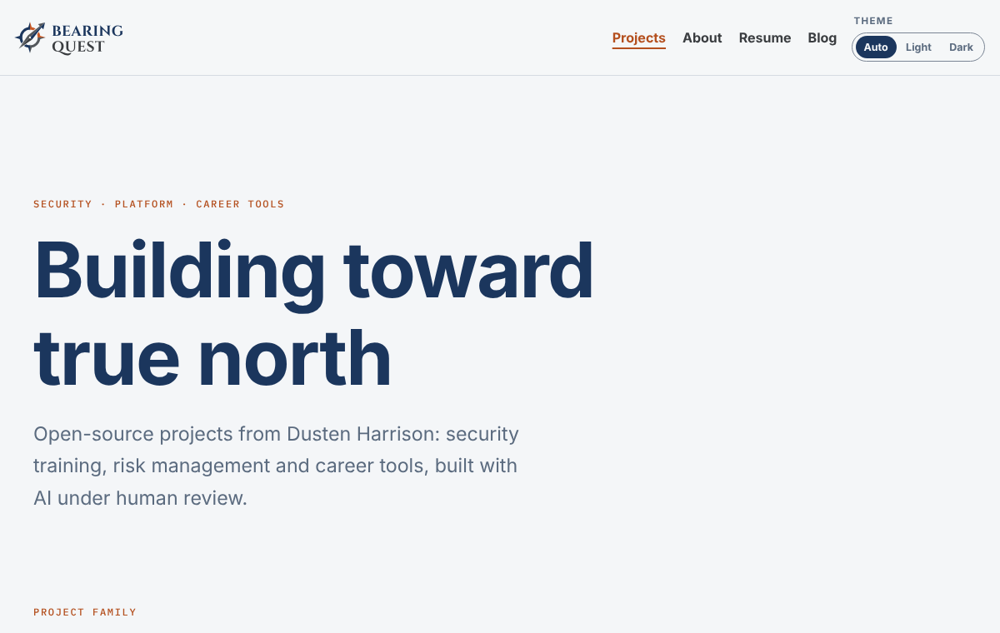
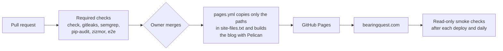

<p align="center">
  <a href="https://bearingquest.com">
    <picture>
      <source media="(prefers-color-scheme: dark)" srcset="docs/readme/bearing-quest-lockup-on-dark.svg">
      
    </picture>
  </a>
</p>

<h1 align="center">Bearing Quest website</h1>

<p align="center">
  The source of <a href="https://bearingquest.com">bearingquest.com</a>.<br>
  Part of the <a href="https://bearingquest.com">Bearing Quest</a> project family.
</p>

<p align="center">
  <a href="https://github.com/BearingQuest/bearingquest.github.io/actions/workflows/ci.yml"></a>
  <a href="https://scorecard.dev/viewer/?uri=github.com/BearingQuest/bearingquest.github.io"></a>
  <a href="LICENSE"></a>
</p>

This repository contains the static website for Bearing Quest, a family of
personal software projects by Dusten Harrison.

The pages are hand-written HTML5 and CSS, with a small same-origin JavaScript
file for theme selection. The blog under `/blog/` is built from `content/blog`
by Pelican, which is locked in `uv.lock` (the `site` dependency group). The
published site loads nothing from other domains and has no analytics or
trackers. A GitHub Actions workflow (`.github/workflows/pages.yml`) publishes
only the paths listed in `site-files.txt`, plus the built blog, to GitHub Pages.

<picture>
  <source media="(prefers-color-scheme: dark)" srcset="docs/readme/site-home-dark.png">
  
</picture>



## Local preview

Build the site the way the deploy does, then serve the folder with any static
HTTP server (needs [uv](https://docs.astral.sh/uv/); the folder must not exist yet):

```text
bash scripts/build-site.sh /tmp/bq-site
python3 -m http.server --directory /tmp/bq-site 8000
```

Then open http://localhost:8000. `make blog` builds only the blog, into
`_build/blog`.

## Tests

With [uv](https://docs.astral.sh/uv/) installed:

```text
make check   # ruff lint, ruff format check, then pytest
make audit   # pip-audit every package locked in uv.lock
make blog    # build the blog with Pelican into _build/blog
make sbom    # CycloneDX SBOM of the locked site group, into _build
make smoke   # read-only check of the live site (needs network)
make hooks   # once per clone: pre-push runs gitleaks on the pushed commits
```

The pre-push hook needs gitleaks (`brew install gitleaks`).

## Licensing

The site code is available under the MIT License. Site text is © 2026
Dusten Harrison, all rights reserved.

The self-hosted fonts (Inter, IBM Plex Mono and Cinzel) are licensed under the
SIL Open Font License 1.1; see `assets/fonts/OFL-*.txt`.
