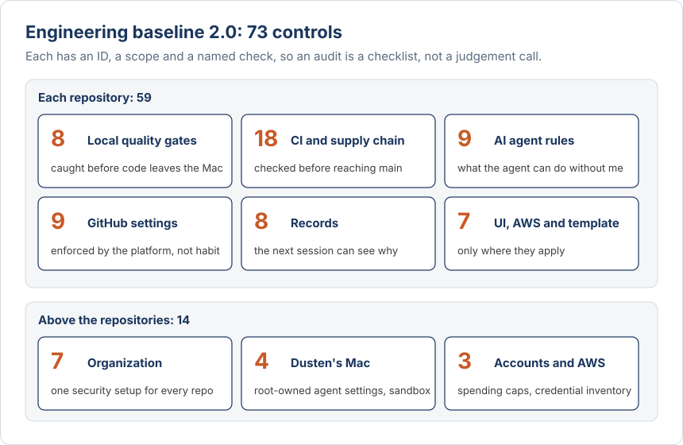
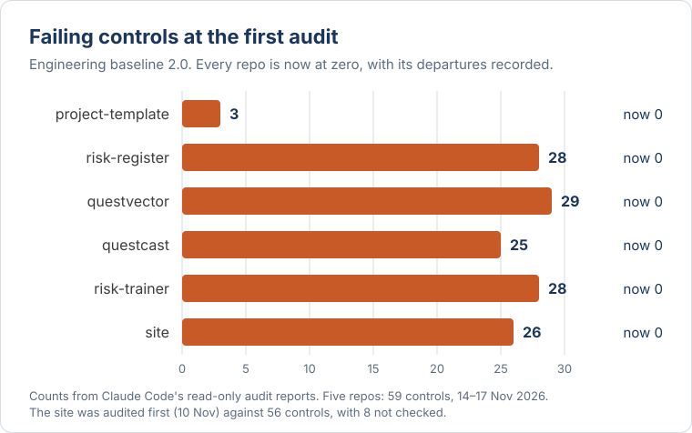
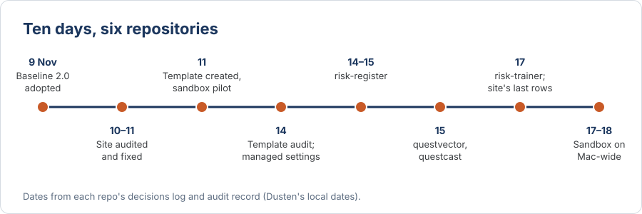
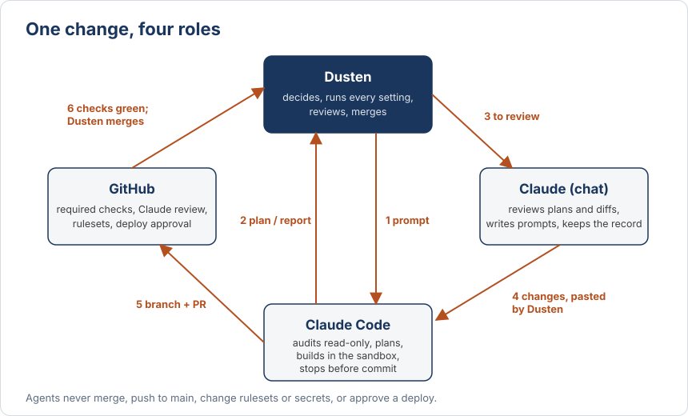
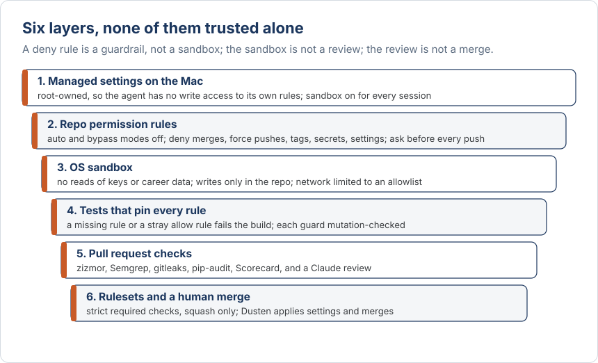

Title: One baseline, six repositories: what changed when I stopped asking Claude for code and started auditing it
Date: 2026-11-20
Slug: baseline-rollout
Summary: How I specified a 73-control engineering baseline, had Claude Code audit six repositories against it read-only, and closed every failing control through small reviewed pull requests, with every merge and setting change left to me.

<figure class="post-hero"><figcaption>Header image generated with Google Gemini.</figcaption></figure>

My personal projects started the way most AI-assisted projects start: one repository at a time, each with whatever rules seemed right that week. By early November I had five repositories in the BearingQuest GitHub organization plus this site, and no two of them were held to the same standard. One had a pre-push secret scan, another didn't. One pinned its GitHub Actions to commit hashes, another pinned some of them. The rules that told Claude Code what it could and couldn't do differed in each.

The trigger was a question I try to ask often: how could this be better? I didn't assume my setup was good enough. On 9 November I asked Claude to review my own standards and setup documents and tell me what to improve. It came back with findings on agent rules, secrets, CI, costs and how the documents themselves were organised. I adopted all of them, and added three asks of my own: turn the GitHub settings I'd been clicking through by hand into commands, give me a prompt that audits every repository against the new standard, and make sure every new project starts with all of it.

So I stopped adding features and did what I would have asked a team to do: write the standard down, audit against it, and fix the gaps in small, reviewable changes.

## What's in the baseline

On 9 November I adopted "engineering baseline 2.0". It's a written catalog of 73 controls: 59 that apply to each repository and 14 for the GitHub organization, my Mac and my accounts. Every control has an ID, the kind of repository it applies to, and a named way to check it, so "does this repo meet the baseline?" has an answer someone else can verify, not just my opinion.

<figure><figcaption>What engineering baseline 2.0 covers</figcaption></figure>

The 59 repository controls fall into six groups. Each one answers a question I'd ask about any team's repository:

- **Local quality gates (8): does a problem get caught before code leaves my Mac?** Each repo gets one `make check` command: lint, type checks and tests, with tests named after the requirement they prove. Dependencies are locked to exact versions. A pre-push hook scans each push for secrets. Each security guard is tested by breaking it on purpose and confirming a test fails.
- **CI and supply chain (18): can anything unsafe reach main?** Five checks must pass before a merge: tests, secret scanning, Semgrep, a dependency vulnerability audit, and zizmor, which scans the GitHub Actions workflows themselves. Every third-party action is pinned to an exact commit, and every workflow token starts read-only. A daily vulnerability scan and Dependabot catch new advisories between changes. Anything that deploys or releases must ship with a software bill of materials (SBOM) listing its dependencies. OpenSSF Scorecard grades each repository's security practices every week. The Claude reviewer on pull requests can leave comments and nothing else.
- **Rules for the AI agent (9): what can Claude Code do without me?** Its fully automatic modes are switched off. Deny rules cover the actions that are mine alone: merging, force-pushing, changing settings, rulesets or secrets, publishing releases. It asks before every push. A sandbox limits what its shell commands can read, write and reach on the network, and with the deny rules keeps it out of my keys and my career data. A test fails if any of those rules goes missing.
- **GitHub settings (9): are the protections enforced by the platform, not just by habit?** Squash merges only, through a ruleset that requires the checks above on a branch that's up to date with main. Secret scanning, push protection and CodeQL are on. Releases can't be changed once published. AWS deploys wait in a protected environment for my approval.
- **Records (8): can the next person, or the next session, see why?** A security policy for reporting problems privately, a pull request template, a decisions log, the rulesets kept as files in the repo, a licence, and a one-time scan of the full history for secrets.
- **Where they apply: UI (4), AWS deploys (2) and the template (1).** The UI controls cover the shared Bearing Quest design system, self-hosted fonts and logos pinned by hash (no font CDN tracking visitors), colour-contrast tests in both themes, and a strict content security policy. The AWS controls cover keyless deploys with a human approval. The template is the starting point every new repository is copied from.

The other 14 controls sit above the repositories. The organization enforces the same security settings on every repository. My Mac has a root-owned settings file that the agent has no write access to. Any paid AI key has its own monthly spending cap.

What 2.0 added over the first version:

- the settings are kept as reviewable code;
- the template repository carries the baseline into every new project;
- workflow scanning and commit-pinned actions are now required;
- the AI agent's sandbox and its root-owned settings are now part of the baseline;
- the catalog itself gives every control an ID, so an audit is a checklist, not a judgement call.

The baseline doesn't demand that every repository look the same. Where a project has a good reason to differ, the difference is recorded as a departure with its reason, in that repository's decisions log. Risk Trainer keeps its own Blueprint theme, for example. A recorded departure counts as meeting the baseline; an unrecorded difference counts as a failure.

## Keeping it current

A baseline is only useful if it stays true, and the first gap I found was in my own setup. New repositories start as a copy of a template repository, and a copy has no link back. Within four days of the template passing its audit, the rollout had taught four lessons that weren't in it: how to push from inside the sandbox, what to do with tests that need a terminal, who runs scripts that open a browser, and when a repository may open a local network port. Every new project would have hit them again.

So the rule now is:

- **Changes go into the template first.** A new baseline version, or a lesson that applies to every repository, lands in the template, with a test for each rule; each repository is then re-audited and fixed.
- **A repository is re-audited when its scope changes.** Its first code or requirements document, first user interface, first website, first release or first cloud deploy brings controls into play that didn't apply before. The template's agent instructions now tell Claude Code to say so in its plan when a change crosses one of those lines. I decide when the audit runs.

## The audit numbers

Claude Code ran a read-only audit of each repository first: no changes, just a report of PASS, FAIL, DEPARTURE or N/A for every control, with the evidence for each.

<figure><figcaption>Failing controls at each repository's first baseline audit</figcaption></figure>

The new project template failed 3 controls. The four older projects failed between 25 and 29 each. This site, audited first on 10 November against an earlier 56-control version of the catalog, failed 26. That's 139 failing controls across six repositories. Today every one of them is at zero failing controls, with its departures written down.

Fixing those took 36 merged pull requests across six repositories between 10 and 17 November, not counting Dependabot's dependency updates.

<figure><figcaption>Baseline 2.0 rollout timeline, 9 to 18 November 2026</figcaption></figure>

## How the work actually ran

The biggest change wasn't in the repositories. It was in how I work with Claude.

<figure><figcaption>How a change ran during the rollout</figcaption></figure>

Each change went around the same loop:

1. I give Claude Code a prompt, written with Claude in a chat session. It starts in plan mode, so the first thing it produces is a plan or an audit report, not code.
2. I take the plan back to the chat, where Claude reviews it against the baseline and the repository's own rules and sends back specific changes.
3. Claude Code makes the change in its sandbox and stops before committing, so I see the diff and the test results first.
4. It opens a pull request. GitHub runs the required checks (secret scanning, Semgrep, zizmor and others), and Claude reviews the pull request as well.
5. I apply any GitHub setting change myself, and I merge. The agents never merge, push to main, change a ruleset or touch a secret.

One Claude writes the code and another Claude reviews the plan, but neither one approves anything. That's my job, and the loop is set up so it stays my job.

## Guardrails, in layers

The second change was in how much I trust any single control.

<figure><figcaption>Layers that keep an AI coding agent inside its lane</figcaption></figure>

A rule that denies `git push --force` matches command text, so it's a guardrail, not a sandbox. The operating-system sandbox limits what a shell command can read, write and reach on the network, but it only covers shell commands. A pull request check catches what gets through both, and a ruleset plus a human merge sits behind all of them. None of these is enough alone, so the baseline asks for all of them.

Two of these layers changed during the rollout. The managed settings file on my Mac is owned by root, and Claude Code runs as my user account, so it has no write access to the rules that limit it. And once every repository passed the sandbox controls, I switched the sandbox on for every Claude Code session on the Mac, not just the projects that ask for it.

The layers caught real mistakes, including Claude's. In one repository, Claude's first draft of the agent permission rules left out the plain form of several commands: a rule for `git push *` doesn't match a bare `git push`. A test I'd required, one that fails if any rule is missing its partner, caught it before the file was used. The baseline also asks for guards like these to be checked by breaking each one on purpose and confirming a test fails.

## What the sandbox taught me

Turning the sandbox on found real limits, and each one became a rule in the next repository's prompt instead of a surprise:

- Only a plain `gh` command is let out of the sandbox, so every `gh` command runs on its own, never chained.
- The sandbox can't write to the repository's git config, so pushes run without the option that sets the upstream branch.
- It can't start a headless browser on macOS, so I ran the one screenshot script myself, after reading it.
- A test that needs a terminal can't get one in the sandbox, so that test skips locally and runs in CI.

None of those is a reason to turn the sandbox off. They're the cost of having it on, and writing them down meant I paid each one once.

## What it cost

This wasn't free, and it wasn't fast. My session logs record about 16.5 hours of my own time between 10 and 18 November, and that doesn't count designing the baseline itself on 9 November. Claude Code does the typing in seconds. The hours go into reading plans, reading diffs, applying settings, approving each push and merge one at a time, and answering the questions the audits raised.

That's the point, though. The speed of the agent moves the bottleneck to review, and review is where my experience counts. I'd rather spend the hours there than discover later what an unreviewed agent did.

## What I'd tell someone starting out

- Ask the AI how your setup could be better, not just for the next task. Don't assume what you've been doing is good enough; that question started all of this work.
- Write the standard before you ask for the code. An agent is very good at meeting a written rule and very bad at guessing an unwritten one.
- Audit read-only first. A report you review is cheaper than a change you undo.
- Keep the approvals human: merges, settings, secrets, deploys.
- Layer your controls and assume each one will miss something.
- Treat a template as a copy, not a link. Put each lesson into it the week you learn it, or every new project relearns it.
- Record every decision where the next session will read it. Chat history gets summarized; a decisions log doesn't.

*Implementation in these projects is AI-generated under my direction and review: I specified and directed the work; Claude Code wrote the code and Claude reviewed the plans. These are personal projects in the Bearing Quest project family.*
